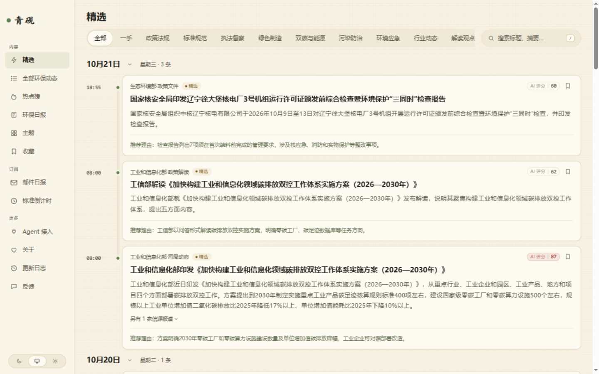
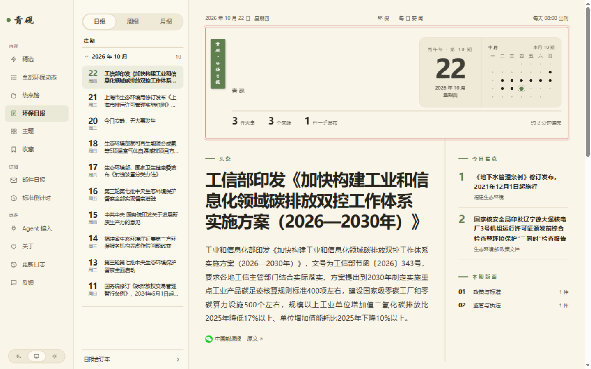
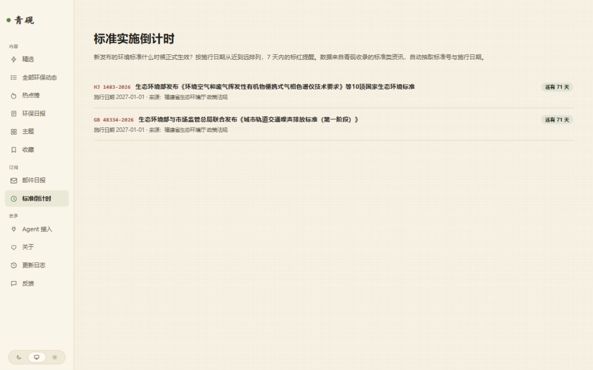

<div align="center">

# 青砚 Qingyan

**环保与双碳行业的热点资讯站 · 基于 [AIHOT](https://github.com/KKKKhazix/AIHOT) 开源引擎的完整行业发行版**

*研环保之墨 · 见行业之先*

[License: MIT](LICENSE) · [上游引擎 AIHOT](https://github.com/KKKKhazix/AIHOT)

</div>

---

## 这是什么

青砚是一个**可以直接跑起来的环保行业热点站**：每天自动从 130+ 信源（生态环境部、工业和信息化部、31 省生态环境厅局、79 个地市局、行业媒体）采集资讯，用大模型两次独立评分做精选，聚合同一事件，每天早上 8 点出一份古籍风格的环保日报。

它同时是 [AIHOT](https://github.com/KKKKhazix/AIHOT) 引擎的一个**完整行业发行版示范**——上游教你方法论，这里给出做成成品的全过程。

## 界面一览

**首页 · 精选流**（分栏滚动，信源徽标 + AI 评分 + 理由朱批）



**环保日报 · 古籍风**（题签、干支纪年、朱丝栏、钤印落款，每天 08:00 出刊）



**标准实施倒计时**（标题内标准号朱色高亮，自动抽取施行日期）



## 相比上游 AIHOT 的差异与增强

| | 内容 | 类型 |
|---|---|---|
| 🆓 | **微信公众号免费采集管道**：we-mp-rss（微信读书通道，不占平台限流配额）+ 推送桥（正文回填、游标断点、首推归档、__noBody 补推）+ ingest 接口正文字段扩展。零 API 费用跑通 130+ 公众号 | 新增管道 |
| 📨 | **邮件体系**：读者订阅每日日报（双确认 + 退订链接 + 古籍风 HTML 模板）、运维告警 + 每日心跳（补齐上游"告警只发飞书"的缺口） | 新增模块 ×2 |
| ⏳ | **标准实施倒计时**：自动抽取标准类文章的标准号与施行日期（"还有 N 天 GB xxx 正式实施"），垂直站刚需 | 新增模块 |
| 🐛 | **上游缺陷修复**：微信文章正文提取（#js_content 直取）、ingest 接口支持正文字段、eval-selection 的 relevance 判定修复、web_list detail 默认 maxFetches=0 的坑 | 补丁 |
| 🏷️ | **省份地域垂直模式**：31 省标签 + 省份主题分组 + 结构化打标规则——任何行业都能套用的"按地区看"模式 | 模式 |
| 🎨 | **古籍风设计语言**：宣纸底 / 松烟墨 / 竹青 / 朱砂印，日报有题签、朱丝栏、干支纪年、钤印落款，热点榜汉字朱批圈号 | 设计 |
| 📚 | **环保行业配置示范**：9 分类 / 35 主题 / 6 个核心提示词 / 130+ 信源 / 校准流程与标注工具 | 配置 |

## 快速开始

> 需要：Docker、Node.js 24+（生成配置用）、一个 OpenAI 兼容的大模型 API Key（DeepSeek / 千问 / 智谱均可）

```bash
git clone https://github.com/evildj1221/qingyan.git
cd qingyan
node scripts/init-env.ts --llm-key <你的模型APIKey>
docker compose up -d --build
```

打开 http://localhost:3000（管理后台 `/admin`，密码在 `.env` 的 `ADMIN_PASSWORD`）。一分钟后开始有内容。

**邮件功能**（订阅日报 + 运维告警）在 `.env` 里配 `NOTIFY_SMTP_USER/PASS`（QQ 邮箱的 SMTP 授权码即可）后生效。

**微信公众号采集**见 [integrations/wemprss-bridge](integrations/wemprss-bridge/README.md)——基于 [we-mp-rss](https://github.com/rachelos/we-mp-rss)，扫码授权后零成本采集，完整教程在内。

## 它是怎么工作的

```
130+ 信源（官网网页 + 公众号读书通道）
    ↓ 定时采集（每 2 小时全量轮巡 + 双消费者队列）
判重 → AI 预筛 → 两次独立评分 → 结构化（分类/标签/标准号/施行日期）
    ↓
聚簇成事件 → 按信源分级门槛精选 → 每天 08:00 生成日报
    ↓
网站 / RSS / 公开 API / MCP / 邮件订阅
```

精选标准、评分维度、全部提示词原文都在 [`industry/prompts/`](industry/prompts/) 里——**改行业 = 改这两个文件夹**，代码不用动。详见 [docs/customize.md](docs/customize.md)。

## 目录导航

```
industry/            行业配置：分类体系、信源、提示词、精选门槛（换行业的核心）
modules/             本发行版新增的四个模块
  feedback-notify/     反馈邮件通知
  digest-subscribe/    邮件订阅日报
  standard-countdown/  标准实施倒计时
  ops-alert/           运维告警 + 心跳
integrations/        we-mp-rss 公众号采集桥（免费管道）
site/                站点配置：品牌、页面、命名、模块清单
apps/ packages/      AIHOT 引擎（上游结构未动）
docs/                上游文档（部署/信源/精选/架构）
```

## 致谢与许可

- 引擎：[AIHOT](https://github.com/KKKKhazix/AIHOT) by [数字生命卡兹克](https://github.com/KKKKhazix)（MIT）
- 公众号采集：[we-mp-rss](https://github.com/rachelos/we-mp-rss)（独立进程部署，通过 HTTP 集成）
- 本仓库代码以 MIT 许可发布；AIHOT 的名称与 Logo 不在授权范围内，本仓库未使用

## 风险与边界（诚实声明）

- 微信读书通道属于个人对个人内容的正常阅读行为，但**不建议高强度使用**；本仓库默认 2 小时轮巡 + 串行队列已是温和频率
- 部分公众号文章页是 JS 空壳，约 8% 内容只能标题展示
- 想要企业级稳定和零维护，可以采购商业公众号数据服务替换本管道（引擎原生支持）

---
*青砚之名取自肇庆端州的端砚——研环保之墨，见行业之先。*
